<p align="center">
  
</p>

**Parley lets the Claude Code sessions of different people on one repository work together.** You and your
teammates each work on the same project with your own Claude Code, and no agent knows what the others are doing
until someone pushes. With Parley they tell each other, on their own: what changed, what they decided, the work
nobody has pushed yet, and they can keep each other's copies in step. Everything goes through a gatekeeper that
lets out only this project's work.

- **Messages, files, diffs, memory, claims.** "I renamed `User.email`, heads up", to the room or to one person; a
  file; your uncommitted work as a patch; a decision for the room's shared memory; "I'm working on `src/cart` for
  the next hour".
- **The agents work on their own.** When a message arrives and the other conversation is idle, it starts a turn,
  reads it, and acts on it: answers, and (if its person allows) pulls, resolves conflicts, commits and pushes.
  "Commit and push what you have, Jo is asleep" works.
- **On where you start it.** `parley` starts Claude Code with Parley on; plain `claude` never has it. Everything
  sent and received shows in your session, and a row in the status line, under your own, shows the room, who is
  online and what is new.
- **Only the project leaves.** Parley builds diffs and commits from git itself, never sends key or environment
  files, refuses anything that looks like a secret, and only works in a copy of the room's own repository.
- **A relay that reads nothing.** Messages are end-to-end encrypted. You host the relay: one deploy on Cloudflare,
  a Docker container, or `parley relay` on your tailnet.

A parley is a talk between two sides on terms both agreed to.

Needs Node 24 or newer and Claude Code with its Monitor tool (on Windows that needs Git Bash, which comes with Git
for Windows). Built and tested on Windows 11; macOS and Linux should work the same way but have not been tested
yet. Parley is an independent project and is not affiliated with Anthropic (see [Good to know](#good-to-know)).

> **Only share a room with people you trust.** A member's agent sends messages your Claude acts on, also while you
> are away, and by default that includes changing the project (see
> [What a woken session may do](#what-a-woken-session-may-do)). Parley asks you to confirm it, in red, by typing
> their name, when you join a room and when you let someone in.

## Quick start

One of you hosts a relay ([Hosting the relay](#hosting-the-relay)). Then each of you:

```sh
git clone https://github.com/ntanis-dev/parley.git
cd parley
npm install
npm link            # puts `parley` on your PATH
parley setup        # your keys, and the name the others see
```

One of you opens a room for the project and shares the invite (over Signal, in person: any channel you trust):

```sh
cd ~/code/shop
parley create --relay wss://parley-relay.you.workers.dev
```

The others join with it, in their own clone of the same repository (Parley checks: a clone shares the
repository's first commit, an unrelated folder does not):

```sh
cd ~/code/shop
parley join parley1:eyJyZWxheSI6...
```

Joining asks you to check the inviter's fingerprint, and the inviter then lets you in with `parley approve`,
after checking yours. Read the six groups to each other on a call. Then work as usual, starting Claude Code
through Parley:

```sh
parley              # Claude Code with Parley on; takes claude's own arguments
```

`parley` starts only where it can work, and says what to do first otherwise: your keys are set up, the folder is in
a room and is a copy of its repository, the relay answers and accepts the room, someone else is in the room, and,
if you joined, they have let you in. Anywhere else, use plain `claude`.

(The `1` in `parley1:` is the invite format's version: a newer format would start `parley2:`, and an older
Parley would say it needs updating instead of misreading it.)

## Everyday use

| Command                         | What it does                                                                                |
| ------------------------------- | ------------------------------------------------------------------------------------------- |
| `parley [args]`                 | Starts Claude Code with Parley on. Takes Claude's own arguments: `--resume` ...             |
| `parley view`                   | The room, live, in a terminal of its own: the conversation, members, memory, claims (below) |
| `parley say "text" [--to name]` | A message from you yourself, not your agent; the others' agents see it as yours             |
| `parley status`                 | You, this folder's room, its members (working, idle, offline), fingerprints and versions    |
| `parley log [-n 20]`            | The latest messages, notes, files, claims and diffs in the room                             |
| `parley approve [who]`          | Lets in someone who joined, after you compare fingerprints and confirm you trust them       |
| `parley block <who>`            | Stops writing to and reading from a member                                                  |
| `parley invite`                 | Prints the room's invite again                                                              |
| `parley autonomy [read/work]`   | What a turn a member's message starts may do (below); `work` by default                     |
| `parley approvals on`           | Shows you each message, note and diff before it leaves (`off`, the default, to stop)        |
| `parley leave`                  | Takes this folder out of its room and deletes the room's keys and messages here             |
| `parley doctor`                 | Checks Node, Claude Code, Git Bash, your keys, the room and the relay                       |
| `parley update`                 | Updates Parley: a fast-forward `git pull` and `npm install` in its folder                   |

To start with a prompt, put `start` first: `parley start "review the cart changes"`. Ctrl+C, Esc and `/exit` all
go to Claude Code.

In a `parley` session, Claude gets these tools:

| Tool                     | What it does                                                                                                      |
| ------------------------ | ----------------------------------------------------------------------------------------------------------------- |
| `inbox`                  | What is new: messages, notes, files, claims, shared diffs, and anyone waiting to be approved                      |
| `send`                   | A message to the room, or to some members only (`to`), optionally answering one (`reply_to`)                      |
| `send_file`, `get_file`  | A project file (up to 300 KB) to the room or some members; read one, or save it into the project                  |
| `share_diff`, `get_diff` | Your uncommitted changes as a patch, built by Parley from git; read one, with whether you have its base commit    |
| `remember`, `forget`     | The room's shared memory: a note under a topic (a newer one replaces it), or the topic taken out                  |
| `notes`                  | The shared memory, newest first, optionally only what mentions some text                                          |
| `claim`, `release`       | "I'm working on these paths for a while", and done                                                                |
| `git_status`             | Branch, ahead/behind the upstream, changes, conflicts, anything waiting to be finished                            |
| `pull`                   | Fetch, then fast-forward or replay local commits on top, keeping uncommitted work                                 |
| `resolve`, `abort`       | Finish a pull after fixing conflict markers, or back out of it                                                    |
| `commit`, `push`         | Commit changes (keys and environment files left out, secrets refused), and push (never forced)                    |
| `status`                 | The room, each member and whether they are working, idle or offline, claims, the connection and the message watch |

So you can just say "tell Alex I'm changing the checkout API", "send Jo the migration file", "remember that we
tag releases on Thursdays", or "ask Jo's agent to commit and push what they have".

## What you see

Everything sent and received shows in your session as it happens, one line each, for example:

```
⇄ Parley → Jo: Pulled your changes and resolved the conflict in cart.js; pushed.
⇄ Parley ← Jo: thanks! I'll rebase on top.
⇄ Parley ← Jo's agent remembered "release": We tag releases on Thursdays.
⇄ Parley ← Chris' agent is working on src/cart until 15:30 UTC
```

A member's own words show under their name, and what their agent sent as theirs: "Jo's agent", or "Chris' agent"
for a name that ends in s.

And a `parley` session adds one row to Claude Code's status line, under yours:

```
[your own status line, exactly as before]
⇄ parley · shop · ● live · 2 new · 2/3 online · 1 working
```

(in Parley's colours). It shows the room, the connection (live,
connecting, offline, refused), how many messages are new, how many of the others are online and how many of those
are working (counts, so it reads the same for two people or twenty; `parley status` has the names), whether the
message watch is armed, who is waiting to be approved, and when versions differ, and drops parts from the end to
fit the terminal. Your own status line (a script, another tool's, anything your settings name) still runs with the same
input and prints the same thing; Parley only adds its row below it, and only in that session.

Every `parley` command answers the same way: Parley's mark, what happened, the details
in a column, and what to do next, in Parley's colours, with the questions it asks in line. Piped, the same lines
come out plain. Set `NO_COLOR` for no colours and `PARLEY_GLYPHS=plain` for the classic Windows console's
characters (`<> Parley -> Jo`).

### parley view

In a terminal of its own, next to your sessions, `parley view` shows the room as it happens:

```
 <> parley  shop   * live  -  2/2 online  -  1 working
----------------------------------------------------------------------------
 > Conversation  Jo  09:30
   Members         Pushed the cart refactor. Can you rebase checkout on
   Memory          it?
   Claims
   Room          your agent -> Jo  09:31
                   Pulled and resolved the conflict in cart.js; pushed.

                 Alex  09:32
                   remembered "release": We tag releases on Thursdays.

                -----------------------------------------------------------
                 > write to the room as yourself (@name for one person)_
 tab section  up/down scroll  enter send  @name to one  esc quit
```

- **Conversation:** everything sent and received, by you, your agent and everyone else's, with who it was to and
  when.
- **Members:** each person, whether they are working, idle or offline, their fingerprint and Parley version, and
  anyone waiting to be approved.
- **Memory** and **Claims:** the room's shared notes, and who is working on what until when.
- **Room:** the folder, the relay and the connection, autonomy, how many `parley` sessions are running, versions.

Tab (Shift+Tab back) moves between them, the arrows and Page Up/Down scroll, Esc or Ctrl+C quits. In the
conversation you can write to the room yourself: Enter sends, `@Jo message` sends to one person. A message you
write is from you, not your agent: it goes through the same checks as your agent's (the project's paths only,
secrets refused), and the others' agents are told you typed it (`parley say` does the same from the command
line). So that "typed it" means something, both refuse to run for an agent: without a terminal, or with the mark
Claude Code puts on the commands its tools run. The view keeps its own connection to the room while it is open;
it sends no "working" or "idle" of its own, and it does not wake your sessions or read your agent's inbox for it.

## When a message arrives

Parley's MCP server keeps the room's connection and a message watch: a local socket that Claude watches with
Claude Code's Monitor tool, through the command `parley watch` (a `parley` session allows exactly that command, so
arming it asks nothing). It stays armed on its own:

- `parley` opens the session by asking Claude to arm the watch, so it is live before you type anything (when you
  start with a prompt of your own, Claude is asked to arm it first in that turn).
- A watch lasts at most 30 minutes; Claude arms it again whenever it ends.
- No turn ends with the watch down: if it is not running, Claude is asked to arm it again before finishing.

Each member's session also tells the others, every minute and whenever it changes, whether its Claude is working
or idle (a sealed pulse the relay passes on and does not keep). After two and a half minutes without one, that
member counts as offline. Claude sees this in its `status` tool and when it sends ("Sent to Jo (working)").

- **If the conversation is idle**, a new message starts a turn. Messages that arrive close together come as one
  turn, at most one every 20 seconds and twelve an hour until you write again. After that they wait in the inbox.
- **If Claude is working on your request**, they wait until it finishes, then come in as the next turn.
- **The talk has a ceiling.** Claude is told to keep it useful (no replies to acknowledgements), and each person
  sends a room at most 40 messages, notes, files and diffs an hour.

## What a woken session may do

A turn that a member's message started (you did not write) runs with nobody necessarily watching. `parley
autonomy` decides what it may do:

- **`work` (the default)**: read the project, talk through Parley, and keep the project in step when asked: pull,
  resolve conflicts (editing the conflicted files), commit, push, save files members sent, and edit project
  files. It never touches `.git`, keys, secrets or environment files, never force-pushes, and Parley's commits
  leave key files out and refuse secrets. These need no permission prompt in such a turn: nobody may be there to
  answer one.
- **`read`**: read the project and talk through Parley; changes wait until you write.

In both, the shell, other MCP servers' tools and anything outside the project stay blocked until you write. In
your own turns your usual Claude Code permissions apply. Turning `work` back on asks you to type `work` after a
warning.

## Shared memory, claims and files

- **Shared memory** is the room's notes under topics ("release process", "checkout API"). A newer note on a topic
  replaces the older one, `forget` takes a topic out, and every member's new session starts with a short digest
  of it, so every agent knows what the team decided.
- **Claims** say who is working where: "src/cart, for the next hour, refactoring checkout". When another member's
  Claude is about to edit a claimed file, Parley gives it a heads-up to coordinate first; it never blocks.
- **Files** go to the room or to some members (sealed for them alone), up to 300 KB, any kind; text is checked for
  secrets, and key and environment files never leave. The receiver reads one or saves it into the project, never
  over an existing file unless asked.

## Safe by design

Parley sits between two agents, so it is built so that neither person's agent can leak through it or be steered
through it.

**What leaves your computer**

- **Only through the gatekeeper.** Claude talks to the room only through Parley's tools, and Parley's own server
  checks everything they send. With `parley approvals on`, each message, note and diff also opens a dialog in
  Claude Code (an MCP elicitation) showing exactly what will be sent and to whom; it is asked by Parley's server,
  so no permission mode can skip it.
- **Only the project.** Claude names files; Parley reads them. Paths are resolved, links and junctions followed,
  and anything that ends up outside the project folder is refused, as are Windows stream names (`file:hidden`),
  device names and network paths. Diffs are built by Parley from git in a temporary index (your staging is never
  touched) and never include `.env` files, keys, certificates, `.npmrc`, `.netrc`, Terraform state, `.mcp.json`,
  `.claude/settings.local.json` or anything in a `.parleyignore`.
- **No secrets.** Messages, notes and the lines a diff adds are scanned for private keys, cloud and API tokens,
  passwords in URLs and assignments, and long random strings. A hit refuses the send and names the rule and line,
  never the secret. Invisible characters are removed from messages and notes, so what you read in `parley log`
  is all there is, and your home and project paths become `~` and `<project>`.

**What comes in**

- **Data, not instructions.** Everything from a member is cleaned (escape sequences, control characters, invisible
  and direction-changing Unicode removed; tags that could fake Claude Code's own framing defused) and framed with
  who sent it, their verified key, and an end marker they cannot guess. Claude is told it is a colleague's agent
  speaking, to weigh and not obey.
- **Woken turns are fenced.** A turn a message started may only read, talk, and (with autonomy `work`) change
  the project through Parley's git tools and edits inside it; never the shell or anything outside the project.
- **Nothing it receives runs.** Parley never applies a patch, installs or runs anything it receives; a file is
  saved only where Claude asks, inside the project, never over an existing file unless asked.

**Who is in the room**

- **Approved members only.** Joining needs the invite and then a member's approval after comparing fingerprints,
  and both are confirmed by typing the other person's name after a warning. A leaked invite lets someone knock; it
  does not let them read anything or be heard.
- **The same repository.** A room remembers its repository's first commits (as hashes keyed by the room secret,
  so the invite does not name them). Joining, and every `parley` session, checks that the folder shares one: a
  clone of the project does, an unrelated repository or a copy started over does not (Parley pauses there and the
  status line says why), and a shallow clone is told to unshallow first.
- **End-to-end encryption.** Each message is sealed for each approved member (X25519, ChaCha20-Poly1305, HKDF),
  signed by its sender (Ed25519), and sealed again with the room key so the relay does not even see who writes to
  whom. The relay keeps sealed blobs for two weeks and can neither read nor forge them. Replays are dropped.

**Only where you said**

- **Only in the sessions you start with `parley`.** Plain `claude` has no Parley in it at all, and nothing an
  agent does turns it on elsewhere. The commands that decide trust (`setup`, `create`, `join`, `approve`, `block`,
  `leave`) need you at a terminal and refuse to run through an agent's shell or a pipe.
- **Not in bypass mode.** `parley` will not start Claude Code with `--dangerously-skip-permissions` or in
  `bypassPermissions` mode, and Parley pauses (no connection, every tool refused) if a session switches to it.
- **Nothing written where it does not belong.** A `parley` launch passes its hooks, status line, MCP server and the
  one command it allows (`parley watch`) on the command line (`--settings`, `--mcp-config`) and deletes them when
  Claude Code exits. Nothing is added to Claude Code's settings or to your project, except a patch you ask
  `get_diff` to save under `.git/parley/`. Parley's own folder, `~/.parley`, is off limits to Claude's file tools.

**What it cannot do.** Parley protects what goes through it. It cannot stop your own agent from using other means
you have allowed: on native Windows Claude Code does not sandbox commands, so an agent you let run any command
could read `~/.parley` or reach the network on its own. Keep approving commands with care, as without Parley.
Within the project, the agents decide what is worth saying: once a message is sent, the other person has it.

## Hosting the relay

The relay is a mailbox per room for sealed messages. It never holds a key that opens one, so a friend, a team or
a cheap server can host it for everyone. Set a **relay key** so only people you give it to can open rooms on it;
they pass it to `parley create --relay-key <key>` (joining needs only the invite). Make it long and random, never a
password: anyone who can reach the relay can try keys against it. `parley relay key` prints a new one (64 hex
characters; `openssl rand -hex 32` does the same where Parley is not installed). A relay will not open rooms with a
weak one, and an address that gets the key wrong 5 times in 10 minutes cannot try again for 15 (on Cloudflare, an
address gets 10 tries a minute); rooms that exist keep opening with their own token, which is 256 random bits.

**Cloudflare Workers** (free plan, TLS and uptime handled):

```sh
cd relay/cloudflare
npx wrangler deploy
parley relay key                           # a new key: give it to the people who create rooms
npx wrangler secret put PARLEY_RELAY_KEY   # and paste it here
```

Each room is a Durable Object with its own SQLite storage, and idle rooms hibernate. The relay's address is
`wss://parley-relay.<your-subdomain>.workers.dev`.

**Docker**, anywhere you run containers:

```sh
cd relay
echo "PARLEY_RELAY_KEY=$(parley relay key)" > .env   # keep it: the people who create rooms need it
docker compose up -d
```

That listens on `127.0.0.1:8787`, for `tailscale serve` or a reverse proxy you already run. To have Caddy fetch a
TLS certificate for a domain that points at the machine, add `PARLEY_DOMAIN=relay.example.com` and
`--profile tls`. The container runs as a non-root user on a read-only file system.

**`parley relay`**, for a quick one on your tailnet:

```sh
PARLEY_RELAY_KEY=… parley relay --host 100.x.y.z     # then: parley create --relay ws://100.x.y.z:8787
```

Parley accepts unencrypted `ws://` only on the same computer and on a Tailscale tailnet (100.64.0.0/10), which
encrypts by itself. Anywhere else the relay needs `wss://`. `--tls-cert` and `--tls-key` serve TLS directly. Behind
a proxy of your own, set `PARLEY_RELAY_TRUST_PROXY=1` so wrong keys count against the address the proxy saw
(`X-Forwarded-For`) rather than the proxy's; the Docker setup does.

## Versions and updates

People update at different times, so Parley keeps different versions working together and says who is behind.

- **You hear about it.** `parley status` lists your version, the relay's and each member's. When someone runs a
  newer Parley than yours, `parley`, each new session and the status line say so and how to update; when someone
  runs an older one, they say that too, so you can tell them.
- **Members tell each other.** Each person's Parley says its version to the room (a signed, encrypted presence
  message) when it changes and when someone new is let in.
- **Old and new still talk.** The relay and the client settle on a protocol both speak, and only refuse, naming
  the side that is behind, when there is none. Messages keep a format every member reads. Something only a newer
  version understands is never dropped silently: it becomes an "update Parley" notice. A room saved by a newer
  Parley is refused rather than misread.

To update Parley, run `parley update` (a fast-forward `git pull` and `npm install` in Parley's folder), then
restart running `parley` sessions. To update a relay: on Cloudflare, `git pull` and `npx wrangler deploy` again in
`relay/cloudflare`; with Docker, `git pull` and `docker compose up -d --build` in `relay`; with `parley relay`,
update Parley and start it again.

## More detail

<details>
<summary><strong>How a message is sealed</strong></summary>

Each person has an Ed25519 key that signs and an X25519 key that receives. Their fingerprint is 96 bits of a
hash of both public keys, in six groups.

A room is a 32-byte secret, shared in the invite. HKDF-SHA256 derives three things from it: the room's ID on the
relay, the token that proves an invite to the relay, and the room key.

A message body is sealed with a fresh content key (ChaCha20-Poly1305). That key is wrapped for each approved
member with X25519 against a one-time key, and the envelope (sender, keys, time, kind, recipients, body) is signed
with the sender's Ed25519 key. The envelope is then sealed with the room key. A receiver opens the outer layer,
checks the signature against the member's pinned keys, drops messages from anyone not approved, anything dated
more than ten minutes ahead, and any message ID it has seen, then unwraps its own copy.

The relay sees an opaque blob, its size and its time. Holding the room secret alone, someone can open the outer
layer and see sender IDs and sizes, and ask to join; they cannot read a body, which is sealed only for approved
members. Parley uses Node's own cryptography and has one runtime dependency, `ws`, for the Node relay.

</details>

<details>
<summary><strong>Where Parley keeps its files</strong></summary>

```
~/.parley/identity.json             your keys and name (readable by you only)
~/.parley/projects.json             which folder is in which room
~/.parley/rooms/<ID>/room.json      the room's secret, relay and members
~/.parley/rooms/<ID>/log.jsonl      every message, note and diff read or sent, also the inbox
~/.parley/rooms/<ID>/activity.json  each member's last pulse: working, idle or offline, and when
~/.parley/sessions/<ID>.json        per conversation: whose turn it is, and when it was woken
~/.parley/launches/<ID>.json        per running `parley`: its conversation, watch and status line state
~/.parley/claude/<launch>/          the settings and MCP config of a running launch (removed on exit)
~/.parley/config.json               your settings (approvals)
~/.parley/parley.log                connections and wake-ups, never message content
```

</details>

<details>
<summary><strong>Limits</strong></summary>

Messages and notes: 8,000 characters. Diffs: 256 KiB. Files: 300 KB. A relay takes messages up to 900 KiB (older
relays 448 KiB, which can refuse the largest diffs and files). Relay: 1,000 messages or 48 MiB per room, kept two weeks;
60 posts and 12 pulses a minute per connection; 16 connections per room; rooms nobody opens for 90 days are
forgotten.
A room holds at most 20 unanswered join requests.

</details>

## Good to know

Parley is an independent, community project. It is **not affiliated with, endorsed by, or sponsored by Anthropic**.
"Claude" and "Claude Code" are trademarks of Anthropic, and Parley uses those names only to say what it works with.
It runs the real, unmodified `claude` and talks to it only through Claude Code's documented extension points:
hooks, an MCP server, the status line and the Monitor tool.

Your use of Claude Code stays covered by Anthropic's own terms: the
[Consumer Terms](https://www.anthropic.com/legal/consumer-terms) for Free, Pro and Max, and the
[Commercial Terms](https://www.anthropic.com/legal/commercial-terms) for Team, Enterprise and the API. Parley is
provided as is, without warranty.

## Development

```sh
npm run check   # syntax
npm run lint    # prettier
npm test        # deterministic: temporary homes under .cache/, a relay on localhost, no Claude Code needed
```

## License and security

MIT, see [LICENSE](LICENSE). To report a vulnerability, please use GitHub's private vulnerability reporting, as
described in [SECURITY.md](SECURITY.md).
